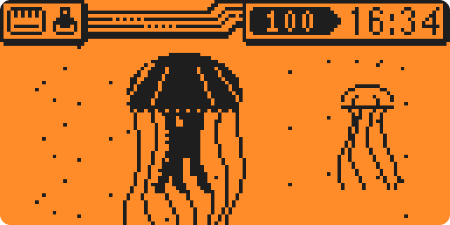
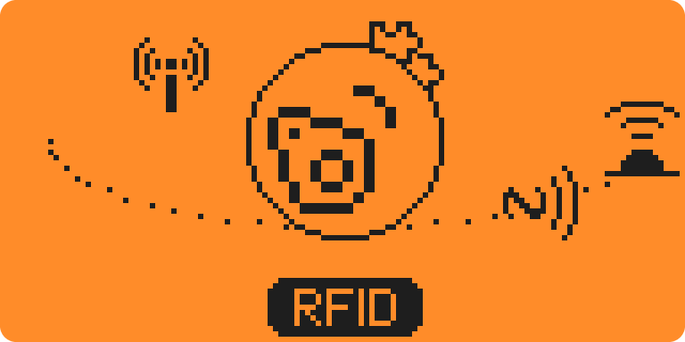
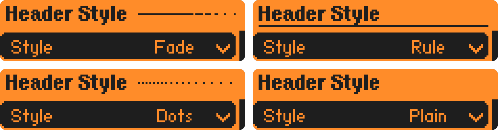
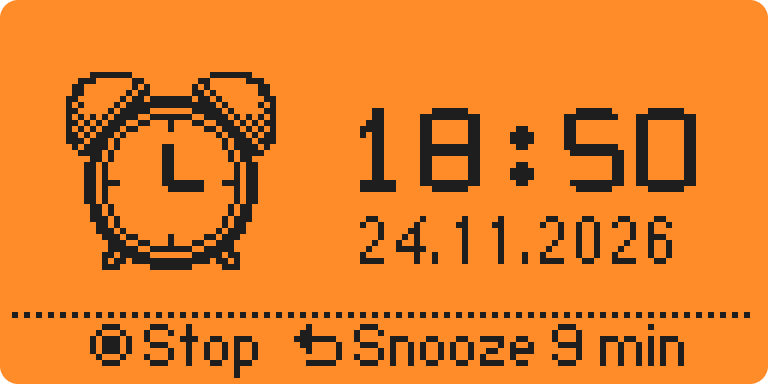

<p align="center">
  <picture>
    <source media="(prefers-color-scheme: dark)" srcset="assets/logo/hadal-logo-dark.png">
    <source media="(prefers-color-scheme: light)" srcset="assets/logo/hadal-logo.png">
    
  </picture>
</p>

<h3 align="center">
  <a href="#highlights">Highlights</a> · <a href="#install">Install</a> · <a href="#build-it-yourself">Build</a> · <a href="#credits">Credits</a>
</h3>

<p align="center">
  
  
  
  
</p>

<br>

**Hadal is custom firmware for the [Flipper Zero](https://flipperzero.one) that goes deeper.** It is built on [Unleashed](https://github.com/DarkFlippers/unleashed-firmware), itself built on the [official firmware](https://github.com/flipperdevices/flipperzero-firmware), and keeps everything they offer. On top of that it hears Bluetooth with nothing but the Flipper's own radio, wears a look of its own, and is tuned for speed and battery life. Its mascot is Abyss, an anglerfish that lights its own way.

<p align="center">
  
  
</p>

> [!WARNING]
> Hadal is in early development, and some features have not yet been tried on real hardware. Use it at your own risk, within the law, and only on devices and signals you own or may work with. Hadal is independent of Flipper Devices and the Unleashed team: please report its issues here, not to them.

<br>

<h2 align="center">Highlights</h2>

Hadal keeps all of Unleashed. Below is what it adds.

<h3 align="center">Bluetooth LE, heard by the Flipper itself</h3>

The Flipper's stock radio stack can only advertise. Hadal runs ST's **Full** stack, so the Flipper can listen too, with no ESP32 or add-on board. These apps are in **Apps → Bluetooth**:

| App | What it does |
|---|---|
| **BLE&nbsp;Scanner** | Every Bluetooth LE device nearby, strongest first. Picks out AirTags and other Find My accessories, AirPods, SmartTags, Tiles and Find My Device tags |
| **Tracker&nbsp;Detector** | Warns you (vibration, light and a message) when a tracker away from its owner has moved with you for 10 minutes. Trackers you mark as yours never warn |
| **Find&nbsp;My&nbsp;Stuff** | Pick your earbuds, watch or tag, and a hotter / colder meter walks you to it |
| **Crowd&nbsp;Meter** | How busy a place is, from the phones and watches heard, with a graph of the last 20 minutes |

<h3 align="center">Make it yours</h3>

<p align="center">
  
</p>

- **Control centre** on Up from the desktop: lock, Bluetooth, silent, dark mode, two apps of your choice, and brightness and volume as sliders.
- **Menu Style**: the main menu as the built-in list or one of eleven styles, among them **Sonar** (above) and **PS4**.
- **Header Style**: the line beside the title of every menu and settings page: Fade, Rule, Dots or Plain (below).
- **Main Menu** in your own order, with any app from the SD card. **Desktop Keys** sets what all ten desktop buttons do, pressed or held. The **Lock Screen** can lock at start, show the time, and decide what too many wrong PINs do.

All of it is in **Settings → Hadal → Interface**.

<p align="center">
  
</p>

<h3 align="center">Asset packs, previewed live</h3>

<p align="center">
  
</p>

**Asset Packs** plays each pack's own animation, full screen, before you choose it. Hadal's deep-sea pack comes with the firmware: Abyss lit by his own lure, a jellyfish, a bathyscaphe and a black smoker, with a sonar ping for the loading spinner. Packs made for Momentum load whole. [How packs are laid out](documentation/AssetPacks.md).

<h3 align="center">An alarm worth waking up to</h3>

<p align="center">
  
  
  
</p>

The Clock app's alarm repeats once, every day, on weekdays, on weekends or on the days you pick. It snoozes for 1–30 min and rings for as long as you choose. It can start gently, vibrate and flash the screen. A bell in the status bar shows it is on.

<h3 align="center">Fast, frugal and safe</h3>

- **Apps open up to 37% sooner.** Infrared opens in 107 ms (it took 170).
- **Updates are light.** An update sends about 1 MB instead of 2.7 MB, and installs only what changed.
- **Easy on the battery.** Settings, Archive, the Clock and the Bluetooth tools let the chip sleep deeply between key presses.
- **Checked before it installs.** If the battery, the images or the radio stack are not right, the updater stops before it changes anything. A firmware that fails to start four times in a row is rolled back.
- **Crash reports.** After a crash, `/ext/crash/` on the SD card says what crashed and where. `python3 scripts/crash_report.py <report>` names the functions.
- **Development mode.** Turned on in Settings → Hadal → Interface → Lock Screen, a crash, reboot or update while unlocked and on USB comes back without the PIN.

<details>
<summary><b>Everything else</b></summary>
<br>

**Sub-GHz**
- Ignore a signal for good, skip duplicates anywhere in the list, and autosave every signal
- Save where each signal was received, from the Flipper app on your phone (no GPS module)
- Add your own frequencies and choose which ones the hopper visits, on the Flipper
- Extended range, switched on in Settings → Hadal → Protocols

**Infrared**
- Universal remotes send the codes most devices use first, never the same one twice, at Normal, Fast or Turbo speed
- They learn: a code that worked for you goes first next time

**Desktop and system**
- Levels up to 30
- Battery History: two weeks of charge, and how long it will last
- Spoofing: the Bluetooth address and the serial
- Start-up timeline in `/ext/apps_data/boot/timeline.txt`

**Files and text**
- File browser: sort orders, hidden files, and search in Archive
- Archive opens disk images in Mass Storage, and shows logs, CSV, JSON, INI, XML and YAML as text
- The keyboard has a symbols page
- Long text pages with Left and Right

**Updates**
- A bathyscaphe sinks towards the Challenger Deep as the update goes on
- `update/hadal_update.log` on the SD card records every update

</details>

<br>

<h2 align="center">Install</h2>

> [!NOTE]
> There are no release builds yet. [Build the update package](#build-it-yourself) first, then install it one of these ways.

> <details><summary><code>qFlipper (.tgz)</code></summary><ul>
>   <li>Open <a href="https://flipperzero.one/update">qFlipper</a> and connect the Flipper</li>
>   <li>Click <code>Install from file</code></li>
>   <li>Pick <code>dist/f7-C/flipper-z-f7-update-local.tgz</code> and wait for the update to finish</li>
> </ul></details>

> <details><summary><code>SD card (update folder)</code></summary><ul>
>   <li>Copy the folder <code>dist/f7-C/f7-update-local</code> to <code>SD/update/</code>, with qFlipper's file manager or a card reader</li>
>   <li>On the Flipper, press <code>Down</code> to open Archive, go to <code>update/f7-update-local</code></li>
>   <li>Select <code>update</code>, choose <code>Run</code> and wait for the update to finish</li>
> </ul></details>

> <details><summary><code>Over USB, straight from the build</code></summary><ul>
>   <li>Close qFlipper and connect the Flipper</li>
>   <li>Run <code>./fbt COMPACT=1 DEBUG=0 flash_usb_full</code>: it builds the package and installs it</li>
> </ul></details>

> [!IMPORTANT]
> Coming from another firmware, the first install moves the Flipper's radio from the Light stack to the Full one. The Flipper restarts several times over a few minutes, and you may need to pair your phone again. If an install stalls, repair the Flipper through qFlipper (DFU key combinations: [KeyCombo.md](documentation/KeyCombo.md)). `update/hadal_update.log` on the SD card says how far it got. Installing official or Unleashed firmware through qFlipper takes you back.

<br>

<h2 align="center">Build it yourself</h2>

```bash
git clone --recursive https://github.com/SaberSucky/hadal-firmware.git
cd hadal-firmware

./fbt COMPACT=1 DEBUG=0 updater_package    # the update package, in dist/f7-C/
./fbt COMPACT=1 DEBUG=0 flash_usb_full     # or build and install it over USB
```

On Windows, use `fbt.cmd` for `./fbt`. Build with `COMPACT=1 DEBUG=0`: a debug build may not fit beside the Full radio stack. Setup is as for the official firmware: see [How to build](documentation/HowToBuild.md).

<details>
<summary><b>More build options</b></summary>
<br>

**Check a package** before you flash it:

```bash
python3 scripts/update_package_check.py dist/f7-C/flipper-z-f7-update-local.tgz --expect full
```

**The standard radio stack**, for a package whose radio matches every other firmware's (BLE Scanner then reports that scanning is unsupported; everything else works):

```bash
./fbt COMPACT=1 DEBUG=0 updater_package COPRO_OB_DATA=scripts/ob.data COPRO_STACK_BIN=stm32wb5x_BLE_Stack_light_fw.bin COPRO_STACK_TYPE=ble_light
```

**Community apps**, fetched at a pinned commit and left unmodified, go into the package when you run this before building:

```bash
python3 scripts/bundle_apps.py fetch
```

Their authors and licences are in [THIRD_PARTY_APPS.md](THIRD_PARTY_APPS.md). Some ship no licence file, so check before you redistribute a build.

</details>

<br>

<h2 align="center">Credits</h2>

Hadal would not exist without the work it is built on:

- **[Unleashed Firmware](https://github.com/DarkFlippers/unleashed-firmware)** by @xMasterX, the Unleashed team and contributors. Nearly everything in Hadal beyond the official firmware is their work: please [support them](https://github.com/DarkFlippers/unleashed-firmware#%EF%B8%8F-please-support-development-of-the-project).
- **[Official Flipper Zero firmware](https://github.com/flipperdevices/flipperzero-firmware)** by Flipper Devices.
- **STMicroelectronics** for the STM32WB wireless coprocessor stacks.
- **[Flipper IRDB](https://github.com/Lucaslhm/Flipper-IRDB)** (CC0) by Lucaslhm and contributors, which sets the order universal remotes send codes in.

<h2 align="center">Licence</h2>

Hadal is free software under the [GNU General Public License v3.0](LICENSE), as Unleashed and the official firmware are, and keeps their copyright notices. Third-party parts, such as the STM32WB coprocessor binaries, come with their own licences.
