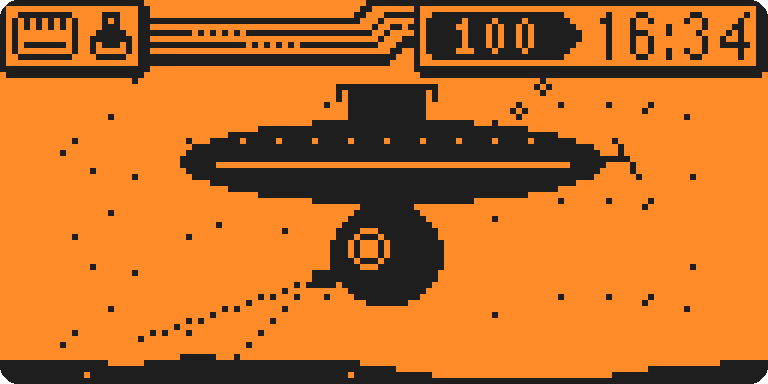
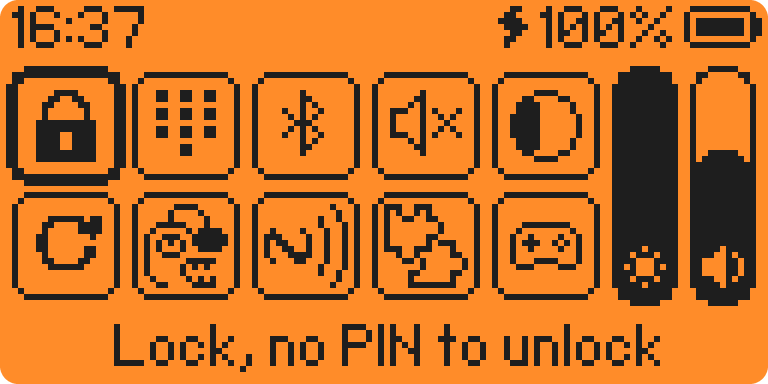
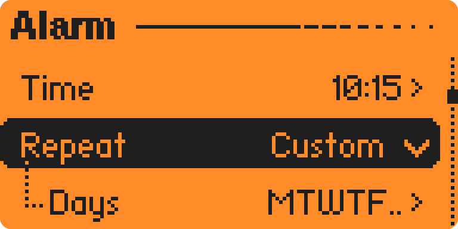
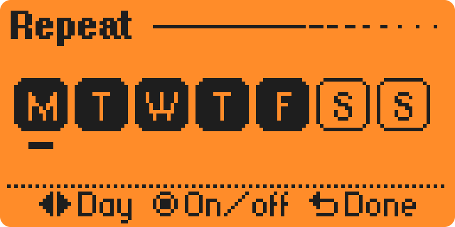

<p align="center">
  <picture>
    <source media="(prefers-color-scheme: dark)" srcset="assets/logo/hadal-logo-dark.png">
    <source media="(prefers-color-scheme: light)" srcset="assets/logo/hadal-logo.png">
    
  </picture>
</p>

<h3 align="center">
  <a href="#highlights">Highlights</a> · <a href="#install">Install</a> · <a href="#build">Build</a> · <a href="#credits">Credits</a>
</h3>

<p align="center">
  
  
  
  
</p>

<br>

**Hadal is custom firmware for the [Flipper Zero](https://flipperzero.one) that goes deeper.** Built on [Unleashed](https://github.com/DarkFlippers/unleashed-firmware) and the [official firmware](https://github.com/flipperdevices/flipperzero-firmware), it keeps everything they offer and adds Bluetooth scanning with the Flipper's own radio, a look of its own, and more speed and battery life. Its mascot is Abyss, an anglerfish that lights its own way.

<p align="center">
  
  
</p>

> [!WARNING]
> Hadal is in early development, and some features have not yet been tried on real hardware. Use it at your own risk, within the law, and only on devices and signals you own or may work with. Hadal is independent of Flipper Devices and the Unleashed team: please report its issues here, not to them.

<br>

<a name="highlights"></a>
<h2 align="center">✨ Highlights</h2>

<h3 align="center">Bluetooth LE, heard by the Flipper itself</h3>

Hadal runs ST's **Full** radio stack, so the Flipper can listen as well as advertise, with no ESP32 or add-on board. In **Apps → Bluetooth**:

| App | What it does |
|---|---|
| **BLE&nbsp;Scanner** | Every device nearby, strongest first. Recognises AirTags, AirPods, SmartTags, Tiles and Find My Device tags |
| **Tracker&nbsp;Detector** | Warns you when someone else's tracker has moved with you for 10 minutes |
| **Find&nbsp;My&nbsp;Stuff** | A hotter / colder meter that walks you to your earbuds, watch or tag |
| **Crowd&nbsp;Meter** | How busy a place is, with a graph of the last 20 minutes |

<h3 align="center">Make it yours</h3>

<p align="center">
  
</p>

- **Control centre**: Up on the desktop. Quick toggles, two apps of your choice, brightness and volume.
- **Menu Style**: the built-in list or one of eleven styles, PS4 and Sonar among them.
- **Header Style**: Fade, Rule, Dots or Plain (below).
- **Main Menu**: your order, with any app from the SD card.
- **Desktop Keys**: each of the ten buttons, pressed or held, opens an action, an app or a file.
- **Lock Screen**: lock at start, a clock, and what too many wrong PINs do.

All in **Settings → Hadal → Interface**.

<p align="center">
  
</p>

<h3 align="center">Asset packs, previewed live</h3>

<p align="center">
  
  
</p>

**Asset Packs** plays each pack's animation before you choose it. Hadal's deep-sea pack ships with the firmware, and packs made for Momentum load whole. [How packs are laid out](documentation/AssetPacks.md).

<h3 align="center">An alarm worth waking up to</h3>

<p align="center">
  
  
  
</p>

The Clock app's alarm repeats once, daily, on weekdays, on weekends or on the days you pick. Snooze and ring length go from 1 to 30 min, with a gentle start, vibration and a flashing screen.

<h3 align="center">Fast, frugal and safe</h3>

<table>
  <tr><td><b>Apps&nbsp;open&nbsp;sooner</b></td><td>Up to 37%: Infrared opens in 107 ms, down from 170</td></tr>
  <tr><td><b>Lighter&nbsp;updates</b></td><td>About 1 MB to send instead of 2.7 MB, and only what changed is installed</td></tr>
  <tr><td><b>Deeper&nbsp;sleep</b></td><td>Settings, Archive, the Clock and the Bluetooth tools let the chip sleep between key presses</td></tr>
  <tr><td><b>Checked&nbsp;first</b></td><td>The updater stops before changing anything if the battery, images or radio stack aren't right</td></tr>
  <tr><td><b>Rollback</b></td><td>A firmware that fails to start four times running is replaced by the last one that ran</td></tr>
  <tr><td><b>Crash&nbsp;reports</b></td><td><code>/ext/crash/</code> says what crashed and where; <code>scripts/crash_report.py</code> names the functions</td></tr>
  <tr><td><b>Development&nbsp;mode</b></td><td>Under Interface → Lock Screen: a crash, reboot or update while unlocked on USB comes back without the PIN</td></tr>
</table>

<details>
<summary><b>Everything else</b></summary>
<br>

**Sub-GHz**: ignore a signal for good, skip duplicates, autosave, save where each signal was received (from your phone), your own and hopper frequencies, extended range.

**Infrared**: universal remotes send the most-used codes first, never twice, at Normal, Fast or Turbo speed, and learn the codes that work for you.

**System**: levels up to 30, Battery History, Bluetooth address and serial spoofing, a start-up timeline.

**Files**: sort orders, hidden files and search in Archive; disk images open in Mass Storage; logs, CSV, JSON, INI, XML and YAML show as text; a symbols page on the keyboard.

**Updates**: a bathyscaphe sinks towards the Challenger Deep as the update goes on; `update/hadal_update.log` records every update.

</details>

<br>

<a name="install"></a>
<h2 align="center">📦 Install</h2>

> [!NOTE]
> There are no release builds yet. [Build the update package](#build) first, then install it one of these ways.

> <details><summary><code>qFlipper (.tgz)</code></summary><ul>
>   <li>Open <a href="https://flipperzero.one/update">qFlipper</a> and connect the Flipper</li>
>   <li>Click <code>Install from file</code></li>
>   <li>Pick <code>dist/f7-C/flipper-z-f7-update-local.tgz</code> and wait for the update to finish</li>
> </ul></details>

> <details><summary><code>SD card (update folder)</code></summary><ul>
>   <li>Copy the folder <code>dist/f7-C/f7-update-local</code> to <code>SD/update/</code></li>
>   <li>On the Flipper, press <code>Down</code> to open Archive and go to <code>update/f7-update-local</code></li>
>   <li>Select <code>update</code>, choose <code>Run</code> and wait for the update to finish</li>
> </ul></details>

> <details><summary><code>Over USB, straight from the build</code></summary><ul>
>   <li>Close qFlipper and connect the Flipper</li>
>   <li>Run <code>./fbt COMPACT=1 DEBUG=0 flash_usb_full</code></li>
> </ul></details>

> [!IMPORTANT]
> Coming from another firmware, the first install moves the radio to the Full stack. The Flipper restarts several times over a few minutes, and you may need to pair your phone again. If it stalls, repair the Flipper through qFlipper ([DFU key combinations](documentation/KeyCombo.md)); `update/hadal_update.log` on the SD card says how far it got. Installing official or Unleashed firmware through qFlipper takes you back.

<br>

<a name="build"></a>
<h2 align="center">🛠️ Build it yourself</h2>

```bash
git clone --recursive https://github.com/SaberSucky/hadal-firmware.git
cd hadal-firmware

./fbt COMPACT=1 DEBUG=0 updater_package    # the update package, in dist/f7-C/
./fbt COMPACT=1 DEBUG=0 flash_usb_full     # or build and install it over USB
```

On Windows, use `fbt.cmd`. Build with `COMPACT=1 DEBUG=0`: a debug build may not fit beside the Full radio stack. Setup is as for the official firmware: see [How to build](documentation/HowToBuild.md).

<details>
<summary><b>More build options</b></summary>
<br>

**Check a package** before you flash it:

```bash
python3 scripts/update_package_check.py dist/f7-C/flipper-z-f7-update-local.tgz --expect full
```

**The standard radio stack**, for a package whose radio matches every other firmware's (BLE Scanner then reports that scanning is unsupported):

```bash
./fbt COMPACT=1 DEBUG=0 updater_package COPRO_OB_DATA=scripts/ob.data COPRO_STACK_BIN=stm32wb5x_BLE_Stack_light_fw.bin COPRO_STACK_TYPE=ble_light
```

**Community apps**, fetched at a pinned commit and left unmodified, go into the package if you run this first:

```bash
python3 scripts/bundle_apps.py fetch
```

Their authors and licences are in [THIRD_PARTY_APPS.md](THIRD_PARTY_APPS.md). Some ship no licence file, so check before you redistribute a build.

</details>

<br>

<a name="credits"></a>
<h2 align="center">❤️ Credits</h2>

- **[Unleashed Firmware](https://github.com/DarkFlippers/unleashed-firmware)** by @xMasterX, the Unleashed team and contributors. Nearly everything in Hadal beyond the official firmware is their work: please [support them](https://github.com/DarkFlippers/unleashed-firmware#%EF%B8%8F-please-support-development-of-the-project).
- **[Official Flipper Zero firmware](https://github.com/flipperdevices/flipperzero-firmware)** by Flipper Devices.
- **STMicroelectronics** for the STM32WB wireless coprocessor stacks.
- **[Flipper IRDB](https://github.com/Lucaslhm/Flipper-IRDB)** (CC0) by Lucaslhm and contributors, which sets the order universal remotes send codes in.

<h2 align="center">📜 Licence</h2>

Hadal is free software under the [GNU General Public License v3.0](LICENSE), as Unleashed and the official firmware are, and keeps their copyright notices. Third-party parts, such as the STM32WB coprocessor binaries, come with their own licences.
